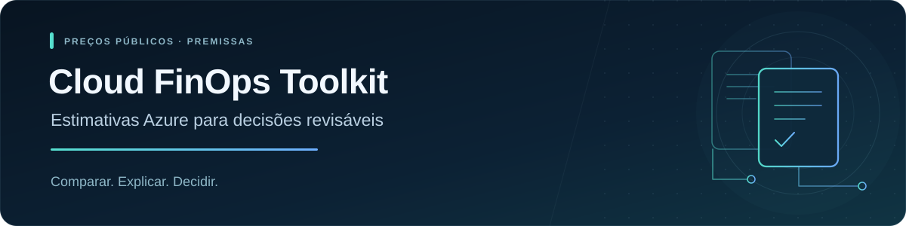

# Cloud FinOps Toolkit

[](https://github.com/TiagoSilveiraSiqueira/cloud-finops-toolkit/actions/workflows/tests.yml)

Compare o custo potencial de agendas e SKUs de VMs Linux no Azure usando Python e um snapshot de preços públicos. O cálculo roda localmente, sem conta Azure, chave de API ou dependências externas.

**Cenários fictícios; preços públicos verificados.** O resultado ajuda a discutir uma proposta de laboratório. Não representa uma fatura, uma recomendação automática de capacidade ou uma economia já realizada.

## Comece em 10 minutos

Requisito: **Python 3.10 ou superior**. Baixe os arquivos, abra a pasta e execute:

```powershell
python estimate.py
python estimate.py examples/laboratorio.json --json
python estimate.py examples/redimensionamento.json
python -m unittest discover -s tests -v
```

No Windows, se sua instalação usa `py`, substitua `python` por `py`. No Linux/macOS, use `python3` quando necessário.

O programa lê os JSON locais. Não consulta a internet, atualiza preços, coleta inventário ou modifica recursos cloud. `--json` inclui os recursos calculados, a proveniência e o SHA-256 do catálogo utilizado.

## Preços que você consegue conferir

O [catálogo](catalog/prices-brazilsouth.json) foi obtido da **Azure Retail Prices API**, pública e sem autenticação. Consulta registrada em **2026-11-24T23:59:14Z**, com HTTP 200. Os três itens têm `effectiveStartDate` igual a `2025-10-01T00:00:00Z`.

| ARM SKU | Produto | Medidor | USD por `1 Hour` |
| --- | --- | --- | ---: |
| `Standard_B1s` | Virtual Machines BS Series | B1s | 0.0168 |
| `Standard_B2s` | Virtual Machines BS Series | B2s | 0.0672 |
| `Standard_B2ms` | Virtual Machines BS Series | B2ms | 0.134 |

Região: `brazilsouth` (Brazil South). Moeda: `USD`. Modalidade: `Consumption` regular. Foram excluídos Windows, Spot, Low Priority, Reservation e DevTestConsumption. A seleção também exigiu medidor regular, `1 Hour`, camada mínima zero e região de medidor principal. A API trouxe seis itens; três preços Windows foram excluídos.

O catálogo preserva SKU, produto, medidor, unidade, moeda, `retailPrice`, início de vigência, fonte e data UTC da consulta. `retailPrice` é armazenado como texto decimal para preservar o valor lido e calcular sem ponto flutuante binário.

**É um snapshot:** a data de consulta indica quando o preço foi visto. O início de vigência fornecido pela API não comprova que o valor continua igual no momento em que você usar a ferramenta. Preço de varejo também pode diferir de contratos e descontos. A CLI não verifica preços atuais.

## Receita: uma agenda para o laboratório

Abra [examples/laboratorio.json](examples/laboratorio.json). O período hipotético tem **730 horas**, não é uma afirmação sobre a duração de todo mês. Cada `hours` representa horas cobradas **por instância** nesse período.

O cálculo por grupo é:

```text
custo de compute = quantidade × horas por instância × USD por hora
diferença potencial = total base − total proposto
percentual potencial = diferença ÷ total base × 100
```

Todos os recursos dos dois cenários usam o mesmo catálogo, moeda, região e duração de referência. A agenda é uma hipótese que precisa ser validada conforme o uso do laboratório.

| Grupo fictício | Base | Proposto | Custo base USD | Custo proposto USD |
| --- | --- | --- | ---: | ---: |
| app-lab | 2 B2s × 730 h | 2 B2s × 220 h | 98.112 | 29.568 |
| apoio-lab | 1 B1s × 730 h | 1 B1s × 220 h | 12.264 | 3.696 |
| teste-lab | 1 B2ms × 160 h | 1 B2ms × 80 h | 21.44 | 10.72 |
| **Total** | | | **131.816** | **43.984** |

Resultado reproduzível: **USD 87.832 de diferença potencial**, equivalente a **66.63%**, arredondado apenas no percentual. Custos de cada linha e o total mantêm os decimais; não são arredondados a centavos antes da soma.

Saída resumida:

```text
Base: USD 131.816
Proposto: USD 43.984
Diferença potencial (base - proposto): USD 87.832
Percentual potencial: 66.63%
```

**Atenção à premissa operacional:** segundo a documentação Azure, uma VM `Stopped` ainda alocada é cobrada por compute; `Deallocated` não é cobrada por esse uso de instância. Reduzir as horas cobradas pressupõe o estado apropriado fora da agenda, com validação e autorização. Este programa não desliga nem desaloca VMs. Discos e outros recursos podem continuar gerando cobranças.

## Receita: comparar um SKU menor

[examples/redimensionamento.json](examples/redimensionamento.json) compara uma VM fictícia B2ms com uma B2s durante as mesmas 160 horas:

- Base: `0.134 × 160 = USD 21.44`.
- Proposto: `0.0672 × 160 = USD 10.752`.
- Diferença potencial: `USD 10.688`, ou `49.85%`.

Esse cálculo **não demonstra** que o SKU menor atende à carga. Antes de decidir, confira CPU, memória, comportamento de carga e particularidades da série B, além dos requisitos do serviço. Não há métricas reais de desempenho no exemplo.

## Como adaptar os dados

Copie um exemplo para `local/meu-cenario.json`, pasta ignorada pelo Git, e ajuste apenas nomes fictícios, SKUs disponíveis no catálogo, quantidades e horas.

```powershell
python estimate.py local/meu-cenario.json --json
python estimate.py local/meu-cenario.json --catalog catalog/prices-brazilsouth.json
```

Esquema do cenário:

| Campo | Regra |
| --- | --- |
| `schema_version` | Inteiro 1 |
| `title` | Texto curto |
| `period_hours` | Número maior que zero, até 1.000.000 |
| `currencyCode`, `armRegionName` | USD e brazilsouth, iguais ao catálogo |
| `base`, `optimized` | Cada um contém `label` e lista `resources` |
| Recurso | Exatamente `name`, `armSkuName`, `quantity`, `hours` |
| `quantity` | Inteiro de 0 a 1.000.000; representa instâncias iguais |
| `hours` | Número de 0 até `period_hours`, até oito casas decimais |

Campos desconhecidos, nomes duplicados dentro de um cenário, SKU ausente, números negativos, booleanos usados como números, NaN/Infinity, unidade desconhecida e moedas misturadas são rejeitados. Quantidade fracionária também é rejeitada. Números do cenário devem ser números JSON, não textos.

Catálogos aceitam somente medidores horários regulares, sem camadas, em USD/Brazil South. Também validam a proveniência e excluem produtos Windows, Spot, Low Priority e Reservation. A validação confere a estrutura; não autentica um arquivo editado nem consulta novamente a fonte.

Listas vazias ou quantidade zero representam compute zero. Se a base for zero, o percentual é indefinido e aparece como `null` no JSON. Se o proposto custar mais, a diferença fica negativa e a saída informa aumento potencial.

## Usar o resultado em uma decisão de liderança

1. Registre o objetivo: reduzir horas de um laboratório ou avaliar capacidade, sem presumir que a hipótese é adequada.
2. Guarde cenário, snapshot e hash utilizados na comparação.
3. Confira a agenda necessária, dependências, desempenho e custos fora do escopo.
4. Apresente a diferença como **potencial**, junto das premissas e da aprovação necessária.
5. Depois de uma mudança autorizada, compare uso e custo efetivamente observados com a hipótese. A ferramenta não faz essa medição.

O escopo é **compute de VM**. Não inclui discos, snapshots de armazenamento, rede, tráfego de saída, balanceadores, licenças adicionais, suporte, descontos negociados, conversão para BRL ou impostos. Não soma recursos com outras unidades. O `optimized` do JSON é um cenário proposto, não uma otimização validada.

## Testes e contribuição

Os testes verificam precisão Decimal, múltiplas instâncias, horas fracionárias, somas sem arredondamento prematuro, diferença potencial, base zero, aumento de custo e entradas inválidas. A CI executa os testes e os exemplos com Python 3.10 e 3.13, usando o catálogo versionado, sem consultar APIs nos testes.

Veja [CONTRIBUTING.md](CONTRIBUTING.md). Atualizações de preço devem ser manuais, com fonte pública, data UTC real e critérios de seleção; não há refresh automático.

## Fontes oficiais

- [Azure Retail Prices API](https://prices.azure.com/api/retail/prices): a URL exata e os filtros da consulta estão no catálogo.
- [Documentação da Azure Retail Prices API](https://learn.microsoft.com/en-us/rest/api/cost-management/retail-prices/azure-retail-prices).
- [Estados de VM e cobrança](https://learn.microsoft.com/en-us/azure/virtual-machines/states-billing).

As duas páginas de documentação foram verificadas por HTTP público com resposta 200 durante a preparação deste projeto. Os preços são dados públicos da Microsoft; a licença do projeto não relicencia documentos externos ou marcas.

## Autor e licença

[Tiago Silveira Siqueira](https://github.com/TiagoSilveiraSiqueira) · Supervisão de TI, cloud e IA aplicada.

Código e documentação autoral sob a [licença MIT](LICENSE).
